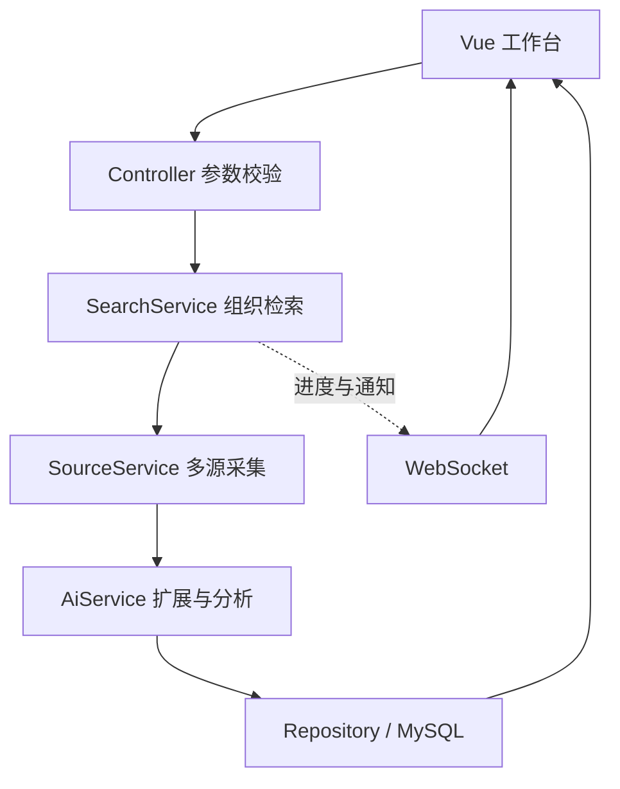

# AIHot · 个人热点研究台

**一个基于 Java 21、Spring Boot、Spring AI 和 Vue 3 的多源信息检索与关键词监控项目。**

输入一个话题，从多个公开信息源聚合相关内容；按需使用大模型生成关键词别名、分析相关性和摘要，再将结果保存到 MySQL。对长期关注的话题，可以设置定时扫描，在发现符合条件的新内容时生成通知。


[功能与用途](#功能与用途) · [技术栈](#技术栈) · [本地-docker-部署](#本地-docker-部署) · [本机开发](#本机开发) · [服务器部署](#服务器部署) · [面试演示建议](#面试演示建议)

## 功能与用途

AIHot 适合持续关注产品发布、开源项目、技术趋势或特定主题。它把分散的信息收集到一个工作台中，减少重复打开多个平台、反复搜索同一个关键词的操作。

| 功能 | 当前实现 |
|---|---|
| 多源检索 | Google News、Bing、DuckDuckGo、Hacker News、GitHub、搜狗微信、哔哩哔哩、微博；各来源独立返回状态 |
| AI 关键词扩展 | 生成精准别名、缩写和中英文变体；限制扩展数量和额外采集次数 |
| AI 内容分析 | 输出相关性、置信度、重要程度、摘要和关联说明；可展开查看分析依据 |
| 网页个人 AI 设置 | 填写 OpenAI 兼容 Base URL、模型名和 Key，用于当前标签页的手动检索 |
| 热点库 | MySQL 持久化、标题搜索、来源/时间/重要性筛选、分页、排序和收藏 |
| 关键词监控 | 独立配置启停和扫描间隔，支持立即扫描；最多 30 个监控词 |
| 通知 | 站内未读通知、WebSocket 事件、可选浏览器提醒及重要热点邮件 |
| 运行记录 | 展示每次检索的状态、采集/分析/入库数量和部分来源失败情况 |
| 规则降级 | 未配置 AI 时使用文字匹配；AI 调用失败时标记降级，不伪装成模型分析成功 |

手动检索用于临时查询，关键词监控用于后台持续查询。检索结果可通过“持续关注”加入监控，两者共用采集、分析和保存流程。

> AI 分析基于采集到的标题和摘要，不能替代事实核查。信息源可能因网络、限流或平台访问策略失败；项目不会用虚构数据填充检索结果。

## 技术栈

| 层次 | 技术 | 用途 |
|---|---|---|
| 后端语言 | Java 21 | 业务处理、任务调度和数据模型 |
| 服务框架 | Spring Boot 3.5.11、Spring MVC | REST API、参数校验、统一异常响应 |
| AI 接入 | Spring AI 1.1.2、OpenAI 兼容协议 | 关键词扩展、内容分析、供应商切换 |
| 数据访问 | Spring JDBC、MySQL Connector/J | 参数化 SQL、事务和数据库分页 |
| 数据库 | MySQL 8.x | 热点、监控词、通知、判断缓存及运行记录 |
| 信息采集 | Java HttpClient、Jsoup 1.18.3 | HTTP 请求、RSS/HTML/JSON 解析、来源限速与超时 |
| 前端 | Vue 3.5、TypeScript 5.6、Vite 7.3 | 页面组织、类型检查、组件与构建 |
| 实时与邮件 | Spring WebSocket、Spring Mail | 检索进度、新热点通知和 SMTP 提醒 |
| 测试 | JUnit 5、Mockito、MockMvc、H2 | 接口、业务流程、解析和访问控制测试 |
| 构建与部署 | Maven、npm workspaces、Docker Compose、Nginx | 前后端构建、容器部署和 HTTPS 反向代理 |

数据库访问采用 **Spring JDBC**。当前没有使用 JPA、MyBatis、Redis、消息队列、向量数据库或多步骤 Agent，部署时也不需要额外启动这些服务。

## 主要实现思路

- **采集与分析分开**：各来源并行采集并保留各自的状态；一个来源失败时，仍可以使用其他来源的结果。
- **URL 去重**：规范化链接并清除已识别的追踪参数，同一内容可以关联多个监控词，收藏状态与发现时间得以保留。
- **控制 AI 调用预算**：分析前先计数，失败和被过滤的内容也消耗本轮预算；轮流处理各来源，避免首个来源占满名额。
- **复用分析结果**：缓存关键词扩展和文章判断；自定义模型的缓存指纹包含接口、模型和密钥信息，避免不同设置混用结果，明文 Key 不写入数据库。
- **任务防重入**：用进程内原子状态协调手动检索和定时扫描，同一实例已有任务时返回忙碌提示。
- **明确通知条件**：仅对监控中新保存且经过 AI 分析的内容生成自动通知；规则降级结果不触发自动通知。
- **可观察的降级**：页面展示来源错误、任务状态和模型降级模式，方便区分“没有匹配结果”和“来源访问失败”。



## 项目结构

```text
aihot/
├── backend/                     Java 后端与测试
│   ├── pom.xml
│   └── src/main/java/cn/aihot/
│       ├── controller/          接口入口与参数校验
│       ├── service/             检索、采集、AI 分析和邮件业务
│       ├── repository/          JDBC 数据读写
│       ├── model/               数据对象
│       ├── config/              配置、WebSocket 和旧数据导入
│       ├── security/            访问令牌与 AI 接口地址限制
│       └── util/                文本、URL、时间等工具
├── frontend/src/
│   ├── views/                   检索、热点库、监控、通知、来源页面
│   ├── components/              热点卡片和 AI 设置弹窗
│   ├── composables/             工作台共享状态和交互
│   ├── api/                     统一接口请求
│   └── assets/                  页面样式
├── project/
│   ├── docs/                    使用、部署和代码阅读文档
│   ├── scripts/                 配置与启动辅助脚本
│   ├── sql/                     建库脚本
│   └── deploy/                  Nginx 配置示例
├── Dockerfile                   多阶段构建前端与 Java 应用
├── compose.local.yaml           Docker Desktop 本地部署
├── compose.yaml                 服务器部署
├── .env.docker.example          本地 Docker 配置模板
└── .env.example                 本机 Java / 服务器配置模板
```

核心阅读顺序：`DiscoverView.vue` → `useWorkspace.ts` → `api/index.ts` → `ApiController` → `SearchService` → `SourceService / AiService` → `HotspotRepository`。

## 本地 Docker 部署

适合第一次运行或向面试官演示。Dockerfile 内部构建前端与 Java 应用，本机不需要另装 Java 和 Maven。首次构建需要能访问 Docker 镜像仓库、npm 和 Maven 仓库。

### 1. 准备环境并获取代码

安装并启动 Docker Desktop，使用 Linux 容器模式，确认引擎处于运行状态。Windows 建议使用 WSL 2 后端。

```powershell
git clone https://github.com/liyihan407-blip/aihot.git
cd aihot
docker version
docker compose version
```

### 2. 创建本地配置

在项目根目录执行，已有配置时不覆盖：

```powershell
if (-not (Test-Path .env.docker.local)) {
    Copy-Item .env.docker.example .env.docker.local
}
notepad .env.docker.local
```

按模板注释填写数据库密码。关键配置如下，示例文字需要换成自己的值：

```properties
MYSQL_PORT=3308
APP_PORT=8787
DB_USERNAME=root
DB_PASSWORD=请设置你自己的本地数据库密码
AI_PROVIDER=bailian
BAILIAN_API_KEY=
BAILIAN_MODEL=qwen-plus
BAILIAN_BASE_URL=https://dashscope.aliyuncs.com/compatible-mode/v1
API_TOKEN=
SCHEDULER_ENABLED=false
```

只做本机演示时 `API_TOKEN` 可留空。未填 AI Key 也可以用规则匹配完成真实来源检索。数据库密码和 API Key 只写入本地配置，不能提交到 Git。

如果本机已有 Node.js，也可以运行 `node project/scripts/setup-docker.cjs` 自动生成配置和随机数据库密码；该脚本保留已有文件。

### 3. 启动数据库和应用

```powershell
# 先检查配置，不打印展开后的密码
docker compose --env-file .env.docker.local -f compose.local.yaml config --quiet

# 先启动 MySQL，便于独立检查数据库状态
docker compose --env-file .env.docker.local -f compose.local.yaml up -d mysql

# 构建并启动前端与 Java 应用
docker compose --env-file .env.docker.local -f compose.local.yaml up -d --build app

# 查看容器状态
docker compose --env-file .env.docker.local -f compose.local.yaml ps
```

MySQL 首次初始化需要一点时间。确认 `mysql` 健康、`app` 正在运行，再访问 **http://127.0.0.1:8787**。

| 访问位置 | 地址 |
|---|---|
| 浏览器 | `http://127.0.0.1:8787` |
| 数据库工具 | 主机 `127.0.0.1`，端口 `3308`，数据库 `aihot`，账号 `root`，密码为配置的 `DB_PASSWORD` |
| 应用容器连接数据库 | `mysql:3306`；这是 Docker 内部地址，无需改成 3308 |

数据库与账号由 MySQL 镜像初始化，业务表由 Spring Boot 启动时初始化。本地版 MySQL 与服务器版使用各自的数据卷。

Windows 也可双击根目录的 `启动Docker本地.cmd`；此脚本使用 Node.js 配置助手。请在文件资源管理器中执行，网页上的代码预览不会运行脚本。

### 4. 日常操作

```powershell
# 查看应用日志
docker compose --env-file .env.docker.local -f compose.local.yaml logs -f app

# 查看数据库日志
docker compose --env-file .env.docker.local -f compose.local.yaml logs --tail=100 mysql

# 停止容器并保留数据库
docker compose --env-file .env.docker.local -f compose.local.yaml down

# 再次启动
docker compose --env-file .env.docker.local -f compose.local.yaml up -d

# 修改代码后重新构建应用
docker compose --env-file .env.docker.local -f compose.local.yaml up -d --build app
```

数据存放在命名卷 `aihot-local_mysql-data`。**`down -v` 会删除数据库卷**，日常停止不要附加 `-v`。已有卷的数据库密码不会因为修改配置文件而自动改变；请按 MySQL 账号管理方式修改密码。平时打开网页无需重新构建，修改源码后才需要更新应用镜像。

## AI 配置方式

### 网页个人设置：手动检索

点击右上角 **AI 设置**，填写 Base URL、模型名称、API Key，保存后勾选“AI 分析”并检索。Base URL 应以 `/v1` 结尾，不包含 `/chat/completions`。

| 服务 | Base URL 示例 | 模型示例 |
|---|---|---|
| 阿里云百炼（北京按量付费） | `https://dashscope.aliyuncs.com/compatible-mode/v1` | `qwen-plus` |
| SiliconFlow | `https://api.siliconflow.cn/v1` | 账号可用的模型 ID |
| OpenRouter | `https://openrouter.ai/api/v1` | 账号可用的模型 ID |
| OpenAI | `https://api.openai.com/v1` | 账号可用的模型 ID |

网页设置保存在当前标签页的 `sessionStorage`；手动检索时提交给本项目后端，由后端请求所填平台。明文 Key 不写入数据库，也不会返回到检索结果中。关闭标签页后需要重新填写。保存设置不代表已通过真实连接测试。

默认只允许指定平台域名，接口须为 HTTPS 且使用标准端口。其他可信服务由管理员通过 `AI_ALLOWED_HOSTS=api.example.com` 加入，多个域名用英文逗号分隔；Docker 本地版在 `.env.docker.local` 中配置并重新创建 app 容器。密钥与模型必须属于对应服务和地域。

### 服务器配置：定时监控

后台监控及监控词“立即扫描”使用服务器的 AI 配置，与当前标签页的个人设置独立。以本地 Docker 配置为例：

```properties
AI_PROVIDER=bailian
BAILIAN_API_KEY=填写你自己的百炼Key
BAILIAN_MODEL=qwen-plus
BAILIAN_BASE_URL=https://dashscope.aliyuncs.com/compatible-mode/v1
SCHEDULER_ENABLED=true
```

修改后重新执行启动命令，让 app 加载新环境变量。定时扫描可能产生模型调用费用，请根据用途配置间隔；每轮分析预算和来源超时等设置见 [配置与启动指南](project/docs/配置与启动指南.md)。

## 本机开发

适合阅读代码和修改页面。可以只让 Docker 运行 MySQL，Java 在本机运行，Vue 使用 Vite 开发服务器。

1. 准备 JDK 21、Maven 3.9.x、Node.js 22.12+ 或 24、npm。
2. 参照前面的 Docker 步骤启动 `mysql`；如果已有 app 容器占用 8787，先用 `docker compose --env-file .env.docker.local -f compose.local.yaml stop app` 停止它。
3. 创建本机 Java 配置：

```powershell
powershell -NoProfile -ExecutionPolicy Bypass -File .\project\scripts\setup-config.ps1
```

编辑根目录 `.env`，将数据库地址设为本机 Docker 映射端口，并填写与数据库一致的密码：

```properties
DB_URL=jdbc:mysql://127.0.0.1:3308/aihot?useUnicode=true&characterEncoding=UTF-8&serverTimezone=Asia/Shanghai
DB_USERNAME=root
DB_PASSWORD=填写你设置的数据库密码
SCHEDULER_ENABLED=false
```

4. 安装前端依赖：`npm ci`。
5. 在第一个终端执行 `npm run dev:backend`，启动 Java 服务。
6. 在第二个终端执行 `npm run dev`，打开终端显示的 Vite 地址，默认 **http://127.0.0.1:5173**。开发服务器会将 `/api` 与 `/ws` 代理到 8787。

前端修改通常会自动刷新；Java 代码修改后需重新编译或重启服务。在 IDEA 中运行 `AiHotApplication` 时，工作目录设为项目根目录，以读取 `.env`。

```powershell
# 运行后端测试与前端类型检查
npm test
# 构建前端并打包 Java 应用
npm run build
```

构建产物为 `frontend/dist/` 和 `backend/target/aihot-1.0.0.jar`。前端静态资源会打进 Java JAR，完整打包运行时只需一个应用进程。

## 服务器部署

服务器版使用根目录的 `compose.yaml`，默认不暴露 MySQL 端口，应用只绑定服务器本机的 8787，再由 Nginx 提供域名和 HTTPS。服务器需安装 Git、Docker Engine 和 Compose 插件。

```bash
git clone https://github.com/liyihan407-blip/aihot.git
cd aihot
cp .env.example .env
```

编辑 `.env`，至少配置：

```properties
DB_USERNAME=aihot
DB_PASSWORD=填写独立的业务数据库强密码
MYSQL_ROOT_PASSWORD=填写不同的管理员强密码
API_TOKEN=填写随机生成的长访问令牌
PORT=8787
ALLOWED_ORIGINS=https://你的域名
AI_PROVIDER=bailian
BAILIAN_API_KEY=填写自己的Key或者留空
SCHEDULER_ENABLED=false
```

服务器版不要把 `DB_USERNAME` 设为 root，Compose 会创建业务账号。填写真实配置时将未启用的 Key 留空，不要保留“填写自己的Key”文字。

```bash
docker compose config --quiet
docker compose up -d --build
docker compose ps
docker compose logs --tail=100 app
curl http://127.0.0.1:8787/api/health
```

### 域名与 HTTPS（Ubuntu 示例）

先把域名 A 记录指向服务器公网 IP，并在云安全组及服务器防火墙允许 80、443 端口。MySQL 3306 和应用 8787 无需对公网开放。

```bash
sudo apt-get update
sudo apt-get install -y nginx certbot
# 临时停止 Nginx，供 standalone 模式完成 80 端口证书验证
sudo systemctl stop nginx
sudo certbot certonly --standalone -d hot.example.com
```

将 `hot.example.com` 换成自己的域名。证书签发成功后，复制 [Nginx 示例](project/deploy/nginx.conf.example)，编辑域名与对应证书路径：

```bash
sudo cp project/deploy/nginx.conf.example /etc/nginx/sites-available/aihot
sudo nano /etc/nginx/sites-available/aihot
sudo ln -s /etc/nginx/sites-available/aihot /etc/nginx/sites-enabled/aihot
sudo nginx -t
sudo systemctl start nginx
```

如果已经存在同名配置或软链接，直接编辑已有文件。示例已包含 `/ws` 的 WebSocket 升级。确认 `.env` 的 `ALLOWED_ORIGINS` 与域名一致，在浏览器打开 `https://你的域名` 并输入配置的 `API_TOKEN`。

standalone 证书续期也需要临时占用 80 端口。保存 Nginx 停启钩子并先做续期演练（已有其他证书时，请评估这些全局钩子的影响）：

```bash
sudo install -d /etc/letsencrypt/renewal-hooks/pre /etc/letsencrypt/renewal-hooks/post
printf '#!/bin/sh\nsystemctl stop nginx\n' | sudo tee /etc/letsencrypt/renewal-hooks/pre/aihot-nginx >/dev/null
printf '#!/bin/sh\nsystemctl start nginx\n' | sudo tee /etc/letsencrypt/renewal-hooks/post/aihot-nginx >/dev/null
sudo chmod +x /etc/letsencrypt/renewal-hooks/pre/aihot-nginx /etc/letsencrypt/renewal-hooks/post/aihot-nginx
sudo certbot renew --dry-run
# 查看自动续期定时器；如未启用，则启用它
sudo systemctl enable --now certbot.timer
```

该方式续期时会短暂停止 Nginx；已有其他站点的服务器可改用自己的证书管理方式。

### 后续更新

```bash
git pull --ff-only
docker compose up -d --build app
docker compose ps
```

更新保留数据库卷和本地 `.env`；部署前自行备份 MySQL 数据。

对外开放时请使用业务数据库账号、强密码、访问令牌和 HTTPS，并备份数据库。项目目前是共享工作台，不提供用户注册和数据隔离；不同访问者会看到同一套热点、监控词和通知。当前任务锁只在单个 Java 进程内生效，不适合直接扩容多个应用副本。

## 面试演示建议

可以按以下顺序展示，重点解释真实的处理过程：

1. **检索一个具体话题**：选择 GitHub、Hacker News 等来源，观察来源状态和运行进度；说明采集使用公开入口，平台结果受网络影响。
2. **展示 AI 与规则的区别**：打开分析依据，解释相关性与置信度；AI 不可用时应显示降级，不能称为事实核验。
3. **重复相同检索**：查看复用/分析数量，结合代码说明缓存与调用预算；缓存命中还取决于来源内容是否变化。
4. **收藏和筛选**：在热点库演示分页、来源筛选与收藏持久化。
5. **把检索转成持续关注**：添加监控词、调整间隔、启停和立即扫描，查看运行记录。
6. **沿一条请求解释代码**：从页面请求到 Controller、SearchService，再到采集、分析、Repository 和 WebSocket 通知。

适合展开讨论的工程问题包括：第三方来源部分失败如何处理、重复内容怎么识别、模型失败如何降级、分析预算为什么在调用前计数、手动检索和定时任务怎样避免同时执行。

## 验证与功能边界

- 前端已通过 TypeScript 检查与 Vite 构建。
- 本机使用临时离线校验依赖运行过 **18 项后端测试**，覆盖接口验证、采集解析、去重、缓存/预算、收藏、监控关联、通知、访问控制和个人模型设置等。该环境使用了部分替代依赖，不能等同于正式 `pom.xml` 的完整验证。
- 仓库配置 GitHub Actions，使用正式依赖执行前端构建及 Maven 验证；是否通过以本次提交对应的 Actions 结果为准。
- 本项目尚未承诺真实 AI、SMTP、所有外网来源在所有网络环境中可用，也未提供性能压测结论或公网在线演示承诺。
- 单条监控词可以包含多个词，但没有严格的 AND/OR 组合语义；多个独立监控任务互相独立。
- 网页个人模型设置仅用于手动检索，后台监控使用服务器配置。

## 常见问题

| 问题 | 排查方式 |
|---|---|
| Docker Desktop 中没有 AIHot | 确认实际执行了终端命令，而不是在浏览器预览脚本；查看终端错误和 `docker compose ... ps` |
| 无法连接 Docker engine | 确认 Desktop 引擎运行、当前用户具备 Docker 访问权限 |
| 镜像、npm 或 Maven 下载失败 | 检查构建过程中的具体失败域名和网络；不要把“构建开始”当成“部署完成” |
| 网页没有新功能 | 刷新当前标签页；确认服务端使用新静态文件。如果旧镜像仍在运行，重新构建 app |
| MySQL 连接失败 | 本机工具使用 3308，容器内使用 mysql:3306；核对数据库卷首次初始化时的密码 |
| 保存 AI 设置后仍为规则匹配 | 确认勾选 AI 分析，并检查域名许可、模型权限、Key、地域、余额和网络 |
| 监控没有 AI 通知 | 检查服务器 AI 配置、调度开关、监控词启停、新内容是否通过分析；个人标签页设置不会覆盖定时任务 |
| 来源部分失败 | 查看“来源与运行”；外网限制、限流或网页结构变化都可能影响采集 |

## 文档与说明

- [配置与启动指南](project/docs/配置与启动指南.md)
- [Docker Desktop 本地启动](project/docs/Docker本地启动指南.md)
- [项目结构与代码阅读](project/docs/项目结构与代码阅读指南.md)
- [API 说明](project/docs/api-java.md)
- [验证记录](project/docs/validation-java.md)

业务思路参考 [yupi-hot-monitor](https://github.com/liyupi/yupi-hot-monitor)，本仓库采用 Java 后端与 Vue 界面实现，包含多源采集、模型分析、关键词监控与部署配置。
