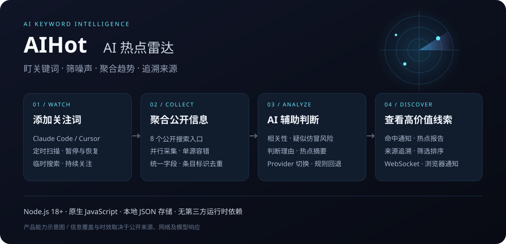

<div align="center">

# 📡 AIHot · AI 热点雷达

**盯住关键词，筛掉噪声，把值得关注的 AI 动态汇集到一个工作台。**

[](https://nodejs.org/)
[](package.json)
[](#ai-配置)
[](package.json)
[](https://github.com/liyihan407-blip/aihot/stargazers)

关键词监控 · 多源搜索 · AI 相关性判断 · 热点发现 · WebSocket 实时通知

[项目概览](#项目概览) · [功能特性](#功能特性) · [快速开始](#快速开始) · [AI 配置](#ai-配置) · [API 接口](#api-接口) · [文档中心](#文档中心)

</div>

<a id="项目概览"></a>
## 🖥️ 项目概览



*上图为产品能力示意图；实际工作台由 `public/` 中的页面提供。*

AIHot 是一个面向 **AI 内容创作者、开发者和技术资讯关注者** 的轻量级热点与关键词监控工具。输入你关心的产品、技术或话题，系统会按周期检索公开信息源，借助 AI 判断内容相关性与疑似仿冒风险，再把命中通知、热点报告和原始来源集中展示。

例如，你可以持续关注 `Claude Code`、`Cursor`、`AI 编程`，也可以临时搜索一个新话题。工作台让你先看到线索，再查看判断理由和原始链接，决定是否值得进一步阅读或分享。

| 适用场景 | 使用方式 |
| --- | --- |
| 📝 内容选题 | 监控 AI 产品和技术话题，查看热点摘要与来源，为选题收集线索 |
| 🧑‍💻 技术追踪 | 关注开发工具、开源项目和社区讨论，减少来回搜索 |
| 🔎 专题研究 | 临时搜索关键词，汇总多个公开来源的候选内容 |
| 🤖 AI 工具集成 | 通过 HTTP API 或仓库内的 Agent Skill 复用监控流程 |

<a id="功能特性"></a>
## ✨ 功能特性

| 能力 | 当前支持 |
| --- | --- |
| **关键词监控** | 保存关注词、定时扫描、暂停与重新开启；重复添加同名词会更新原记录 |
| **关键词与热点联动** | 网页添加监控词时，同时创建关键词监控和同名热点范围 |
| **多源信息聚合** | 接入 8 个公开搜索入口，并行采集；单个来源失败时保留其他来源结果 |
| **AI 内容判断** | 判断相关性、疑似仿冒或钓鱼风险，生成置信度、紧急程度、理由和通知摘要 |
| **热点发现** | 基于候选内容生成话题摘要、热度和风险提示，并关联原始来源 |
| **即时搜索** | 无需创建持续监控，直接检索当前接入的公开信息源 |
| **实时通知** | 通过 WebSocket 同步扫描事件；支持页面通知流和浏览器 Notification |
| **结果筛选** | 按来源、重要性、关键词、时间范围筛选；支持重要程度、热度、相关性和时间排序 |
| **详情追溯** | 展示 AI 判断理由、原始描述、来源链接及可用的发布时间与抓取时间 |
| **响应式工作台** | 深色雷达界面、指标总览、监控侧栏、结果区和通知栏，适配窄屏 |
| **本地持久化** | 使用 `data/state.json` 保存监控项、通知、热点报告和去重记录 |
| **Provider 切换与回退** | 支持 SiliconFlow / OpenRouter；未配置密钥或 AI 调用失败时回退到本地规则 |

> **能力边界：** AI 判断基于抓取到的标题、摘要等候选信息，属于阅读辅助；风险标签不等同于事实核查或安全认证。信息覆盖和扫描时效取决于公开来源、网络、任务数量与模型响应速度。

<a id="工作台"></a>
## 🎛️ 工作台怎么用

| 区域 | 你可以做什么 |
| --- | --- |
| **总览区** | 查看命中通知、关键词、热点范围和报告数量，手动触发扫描 |
| **监控词** | 添加关注词，通过开关暂停或继续扫描，查看任务状态 |
| **热点雷达** | 阅读命中通知与热点报告，展开详情并跳转到来源 |
| **搜索** | 输入临时关键词，查看候选结果和来源错误 |
| **筛选栏** | 缩小来源、时间和关键词范围，调整结果排序 |
| **通知栏** | 查看当前页面连接期间收到的扫描事件和实时连接状态 |

### 从添加关注词到发现线索

1. 打开 **监控词**，添加 `Claude Code` 或你关心的话题。
2. 点击 **立即扫描**，或保持服务运行，等待后台调度。
3. 在 **命中通知** 中查看相关内容，在 **热点发现** 中查看话题汇总。
4. 用筛选栏缩小阅读范围，展开详情核对判断理由和原始来源。
5. 如需桌面提醒，点击 **开启浏览器通知** 并在浏览器中授权。

网页新增关注词默认每 **30 分钟**扫描一次；后台调度器默认每 **60 秒**检查到期任务。两者分别是任务周期和调度检查周期，实际完成时间还包含抓取与模型处理耗时。首次添加后可以手动扫描，无需等待下一个周期。

浏览器通知依赖页面运行、浏览器支持和通知权限；当前不提供关闭页面后的 Service Worker 后台推送。

<a id="快速开始"></a>
## 🚀 快速开始

### 1. 获取项目

需要 **Node.js 18 或更高版本**，以及 Git。

```bash
git clone https://github.com/liyihan407-blip/aihot.git
cd aihot
```

项目使用 Node.js 内置模块，当前没有第三方运行时依赖，可直接启动。

### 2. 配置 AI 服务

Windows PowerShell：

```powershell
Copy-Item .env.example .env
```

macOS / Linux：

```bash
cp .env.example .env
```

用文本编辑器打开 `.env`，默认使用 SiliconFlow + DeepSeek：

```dotenv
AI_PROVIDER=siliconflow
SILICONFLOW_API_KEY=替换为你的真实密钥
SILICONFLOW_MODEL=deepseek-ai/DeepSeek-V3.2
PORT=8787
POLL_SECONDS=60
```

服务启动时自动读取项目根目录的 `.env`；已存在的进程环境变量优先。修改配置后需要重启服务。

> 不填写真实 Key 也可以体验界面与本地规则流程，但抓取公开来源仍然需要网络。使用云端模型可能产生服务商 API 费用。

### 3. 启动工作台

```bash
npm start
```

打开 **[http://localhost:8787](http://localhost:8787)**，添加关注词后即可开始使用。

<a id="ai-配置"></a>
## 🤖 AI 配置

只需配置你当前选择的服务商。默认 Provider 为 `siliconflow`。

| 服务商 | `AI_PROVIDER` | 密钥变量 | 模型变量 | 默认模型 |
| --- | --- | --- | --- | --- |
| SiliconFlow | `siliconflow` | `SILICONFLOW_API_KEY` | `SILICONFLOW_MODEL` | `deepseek-ai/DeepSeek-V3.2` |
| OpenRouter | `openrouter` | `OPENROUTER_API_KEY` | `OPENROUTER_MODEL` | `openai/gpt-4.1-mini` |

<details>
<summary><strong>切换到 OpenRouter</strong></summary>

在 `.env` 中修改以下配置，再重启服务：

```dotenv
AI_PROVIDER=openrouter
OPENROUTER_API_KEY=替换为你的真实密钥
OPENROUTER_MODEL=openai/gpt-4.1-mini
```

模型是否可用取决于服务商当前提供的模型、账户权限与余额。

</details>

<details>
<summary><strong>环境变量完整说明</strong></summary>

| 变量 | 默认值 | 说明 |
| --- | --- | --- |
| `PORT` | `8787` | HTTP 服务端口 |
| `POLL_SECONDS` | `60` | 后台任务检查间隔，代码限制为 15–3600 秒 |
| `AI_PROVIDER` | `siliconflow` | `siliconflow` 或 `openrouter` |
| `SILICONFLOW_API_KEY` | 无 | SiliconFlow 真实密钥 |
| `SILICONFLOW_MODEL` | `deepseek-ai/DeepSeek-V3.2` | SiliconFlow 模型标识 |
| `OPENROUTER_API_KEY` | 无 | OpenRouter 真实密钥 |
| `OPENROUTER_MODEL` | `openai/gpt-4.1-mini` | OpenRouter 模型标识 |
| `CONTEXT7_API_KEY` | 无 | 可选开发工具配置，运行监控服务不需要 |
| `FIRECRAWL_API_KEY` | 无 | 可选开发工具配置，当前运行时采集流程未使用 |

不要将包含真实密钥的 `.env` 提交到 Git；仓库提供的 `.env.example` 仅含占位值。

</details>

### 本地回退模式有什么区别

| 模式 | 行为 |
| --- | --- |
| **已配置可用云端 AI** | 调用所选 Provider，生成内容判断和热点摘要 |
| **未配置可用 Key** | 使用关键词包含、可疑词匹配和基础热度排序等本地规则 |
| **AI 调用失败** | 回退到本地规则，并在判定理由或报告摘要中保留失败说明 |

本地回退用于保持基本流程可用，判断能力与云端 AI 模式不同。它不能替代语义分析，热点分值也不代表全网真实热度。

<a id="信息源"></a>
## 🌐 信息源

| 来源 | 接入方式 | 主要候选内容 |
| --- | --- | --- |
| Google News | RSS 搜索 | 新闻与媒体报道 |
| Bing | RSS 搜索 | 网页搜索结果 |
| DuckDuckGo | HTML 搜索 | 网页与资讯线索 |
| Hacker News | Algolia API | 技术社区讨论与文章 |
| GitHub | Repository Search API | 相关开源仓库与项目描述 |
| 搜狗微信 | 公开搜索页 | 微信公众号文章线索 |
| Bilibili | 公开 Web 搜索接口 | 视频标题、描述和可用互动指标 |
| 微博 | 公开搜索页 | 公开内容与讨论线索 |

这些入口的可用性会受到网络、限流、验证码和页面结构变化影响；“已接入”不代表每次扫描都能拿到全部来源。项目会记录来源错误，单源请求失败不会终止其他来源的采集。

当前没有接入 X / Twitter API、微博官方商业 API 或 B 站开放平台授权接口。

<a id="技术设计"></a>
## 🧩 技术设计

| 层次 | 实现 |
| --- | --- |
| 前端 | 原生 HTML / CSS / JavaScript，响应式深色工作台 |
| 服务端 | Node.js 内置 HTTP 服务，提供静态资源和 JSON API |
| 信息采集 | RSS、HTML 解析与公开 API；多源并行请求及错误隔离 |
| AI 适配 | SiliconFlow / OpenRouter；结构化 JSON 输出解析与本地回退 |
| 调度 | 进程内定时器、到期任务检查、同一进程内的扫描互斥 |
| 实时通信 | WebSocket 推送任务事件，前端另有周期性状态同步 |
| 存储 | 本地 JSON 文件，保存状态与已处理内容标识 |
| 测试 | Node.js 内置 `node:test` |

### 一次扫描会发生什么

1. 调度器或手动刷新触发任务，跳过已暂停的监控项。
2. 并行检索公开来源，统一内容字段，合并并按条目标识去重。
3. 关键词监控对未处理候选逐条判断；热点范围对候选集合生成话题汇总。
4. 符合“相关、非疑似仿冒、置信度至少 0.55”的内容进入命中通知。
5. 状态写入本地文件，任务事件经 WebSocket 推送到已连接页面。

当前每次采集最多保留 **40 条候选**；每个关键词任务最多判断前 **10 条**，热点摘要最多向模型传入前 **18 条**。这些是当前实现的处理上限，项目不承诺穷尽所有相关信息。

### 数据与运行方式

- **状态文件：** `data/state.json`；当前最多保留 100 条命中通知和 40 份热点报告。
- **备份迁移：** 停止服务后备份 `data/`，迁移时放回项目根目录；密钥单独配置。
- **持续运行：** 定时扫描依赖 Node.js 进程存活，关闭终端或停止进程后不再执行。
- **部署边界：** 当前适合个人、单实例使用；尚无登录鉴权和多用户隔离，直接用于公网服务前需要补充访问控制。部署到持久服务器时应保留 `data/`，并配置进程守护；使用浏览器通知的远程页面通常需要 HTTPS。

<a id="api-接口"></a>
## 🔌 API 接口

接口默认地址：`http://localhost:8787`，JSON 请求使用 `Content-Type: application/json`。

优先使用 **`/api/watch-terms`**：它与网页操作一致，添加时同时创建关键词监控和同名热点范围。

| 方法 | 路径 | 用途 |
| --- | --- | --- |
| `GET` | `/api/state` | 读取工作台完整状态及模型配置状态 |
| `GET` | `/api/watch-terms` | 读取关注词，返回 `{ terms: [...] }` |
| `POST` | `/api/watch-terms` | 添加或重新启用关注词，联动关键词监控与热点范围 |
| `PATCH` | `/api/watch-terms/:id` | 更新关键词开关或周期；开关联动同名热点范围 |
| `DELETE` | `/api/watch-terms/:id` | 删除关注词及同名热点范围、相关热点报告 |
| `POST` | `/api/search` | 临时检索公开来源，返回候选内容与来源错误 |
| `POST` | `/api/refresh` | 手动扫描；`target` 支持 `all` / `monitors` / `scopes` |
| `GET / POST` | `/api/keywords` | 单独读取或保存关键词监控 |
| `PATCH / DELETE` | `/api/keywords/:id` | 更新或删除关键词监控 |
| `POST` | `/api/monitors` | 兼容入口：创建关键词监控 |
| `PATCH / DELETE` | `/api/monitors/:id` | 兼容入口：更新或删除监控 |
| `POST` | `/api/scopes` | 单独创建热点范围 |
| `DELETE` | `/api/scopes/:id` | 删除热点范围 |
| WebSocket | `/ws` | 接收连接、命中通知与热点报告事件 |

`/api/keywords`、`/api/monitors` 与 `/api/scopes` 是分项接口；需要与网页相同的联动添加、开关和删除行为时，请使用 `/api/watch-terms`。通过关注词接口修改周期时，当前只更新关键词监控周期，同名热点范围保留原周期。

<details>
<summary><strong>调用示例：添加关注词、立即扫描、临时搜索</strong></summary>

下面的 `curl` 示例适用于 Bash / macOS / Linux：

```bash
curl -X POST http://localhost:8787/api/watch-terms \
  -H 'Content-Type: application/json' \
  -d '{"term":"Claude Code","intervalMinutes":30,"enabled":true}'

curl -X POST http://localhost:8787/api/refresh \
  -H 'Content-Type: application/json' \
  -d '{"target":"all"}'

curl -X POST http://localhost:8787/api/search \
  -H 'Content-Type: application/json' \
  -d '{"query":"AI 编程"}'
```

Windows PowerShell 添加关注词：

```powershell
$body = @{
    term = "Claude Code"
    intervalMinutes = 30
    enabled = $true
} | ConvertTo-Json

Invoke-RestMethod -Uri "http://localhost:8787/api/watch-terms" -Method Post -ContentType "application/json; charset=utf-8" -Body $body
```

</details>

<a id="agent-skill"></a>
## 🦾 Agent Skill

仓库提供 [`skills/aihot-monitor`](skills/aihot-monitor)，供支持读取此类技能说明的 AI 工具参考使用，覆盖服务启动、Provider 配置、监控创建、手动刷新和结果解读。

它复用现有服务与 HTTP API；能否直接安装或自动加载取决于所用 AI 工具。接口细节可参考 [Skill API 说明](skills/aihot-monitor/references/api.md) 和上方当前 API 表。

<a id="测试"></a>
## 🧪 测试与验证

```bash
npm test
```

现有测试覆盖环境变量加载、Provider 切换与占位 Key 识别、AI JSON 容错解析、本地回退与热点排序、RSS / HTML / B 站数据解析，以及关键词暂停和同名更新。

外部来源和真实模型调用受网络、密钥与服务状态影响，需要在实际部署环境中另行验证。历史验证记录见 [docs/validation.md](docs/validation.md)。

<a id="常见问题"></a>
## ❓ 常见问题

**为什么页面显示“本地规则兜底”？**  
所选 Provider 的 Key 未配置或仍为占位值。检查 `.env`、`AI_PROVIDER` 和对应密钥变量，重启服务。

**为什么有些来源没有结果？**  
可能没有匹配内容，也可能受到网络、限流或访客校验影响。查看监控项的错误提示；其他来源仍可继续工作。

**为什么添加后没有立即出现通知？**  
保存关注词与执行扫描是两个步骤。点击“立即扫描”；只有符合判定条件的新内容才会形成命中通知，已有条目标识会被去重。

**暂停后还需要重新输入关键词吗？**  
不需要。暂停保留关注词；重新打开开关后继续扫描。手动刷新也会跳过暂停项。

**支持邮件、飞书、企业微信推送吗？**  
当前支持页面通知流、WebSocket 事件与浏览器通知，尚未内置这些外部推送渠道。

<a id="文档中心"></a>
## 📚 文档中心

| 文档 | 内容 |
| --- | --- |
| [需求沉淀](docs/requirements.md) | 使用场景与需求演进 |
| [技术方案](docs/technical-plan.md) | 技术设计与实现讨论 |
| [验证记录](docs/validation.md) | 历史验证结果及环境限制 |
| [关键词 API](docs/keyword-api.md) | 分项关键词接口的请求示例 |
| [Agent Skill](skills/aihot-monitor/SKILL.md) | AI 工具复用流程 |
| [Skill API 参考](skills/aihot-monitor/references/api.md) | 技能配套接口说明 |

需求和方案文档可能包含设计目标；当前功能与接口请结合本 README 及实际代码确认。

---

欢迎通过 [Issues](https://github.com/liyihan407-blip/aihot/issues) 反馈问题或提出改进建议。反馈来源异常时，可附上来源名称、错误信息和复现步骤，请勿附带真实 API Key。
